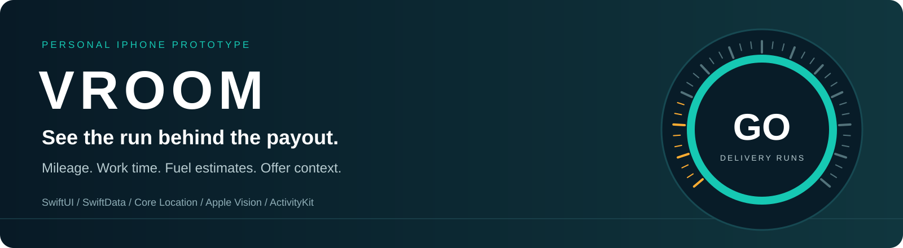

# Vroom · Delivery Shift Tracker

An iPhone prototype built around a practical question: **what did a delivery run
leave after estimated fuel and recorded costs?** Vroom brings run tracking,
earnings, fuel records and user-triggered offer checks into one local workflow.

**Working personal prototype · AI-assisted development · Source kept private · Not an App Store release**

[Explore the screens](docs/screenshots.md) · [Architecture](docs/architecture.md) · [Validation & limitations](docs/validation.md)

## A run, from start to review

1. **Start, pause, resume, stop.** Track accepted GPS mileage and active work time;
   pauses are excluded. Waiting during an active run counts as work.
2. **Record what you earned.** Enter a run's pay or one total for the day. A daily
   total replaces the day's run-pay sum rather than adding it again.
3. **Separate fuel used from fuel bought.** Run costs use saved MPG and price
   assumptions. Fill-ups record actual gallons and money paid separately.
4. **Review the day.** Compare work time, mileage, gross earnings and estimated
   after-cost earnings; copy a daily summary or export CSV.

## Offer context without automatic decisions

A user-configured Shortcut can send a screenshot from Grubhub for an explicit
on-device OCR check. Vroom compares readable offer values against saved hourly,
per-mile, fuel and optional cost assumptions. Results can appear in a Live
Activity and on compatible iPhones in Dynamic Island.

- **Green:** meets the saved targets.
- **Yellow:** a close trade-off or conditional mission scenario needs review.
- **Red:** below the targets or a modeled loss.
- **Gray:** insufficient or uncertain inputs; check the details.

These are **rule-based estimates**, not a trained earnings predictor. Vroom does
not continuously watch another app, know its online state, or accept/reject
orders. A shortcut and permissions must be configured by the user.

## Fuel records and vehicle assumptions

Fuel logging offers a pump-photo entry point and manual entry. Apple Vision
suggests numbers when it can associate them with labels; **gallons and total
paid must be checked before saving**. A posted pump price and the effective
price after rewards are different from a regional market estimate.

The garage keeps vehicle profiles and a delivery MPG assumption. A separate
whole-car baseline can use valid full-tank odometer intervals. It includes
personal driving and is **not a measurement of delivery-only MPG**.

## Selected interface screens

Actual iPhone captures of the offer-import form and empty mission setup.
The public gallery excludes earnings, driving history, fuel transactions,
vehicle profiles, personal settings and the iPhone Home Screen.

<table>
<tr><th>Import an offer</th><th>Configure optional missions</th></tr>
<tr>
<td></td>
<td></td>
</tr>
</table>

## Implementation at a glance

| Area | Implementation |
|---|---|
| Native interface | Swift and SwiftUI, with a cockpit-style run control |
| Run tracking | Core Location mileage filtering, work-time accounting and interruption markers |
| Local data | SwiftData run/fuel records; local preferences and review records |
| Offer input | Apple Vision OCR through explicit screenshot imports and App Intents |
| Glanceable results | ActivityKit / WidgetKit Live Activity extension |
| External data | EPA vehicle lookup, EIA regional fuel estimates, conditional Apple Maps lookup |
| Portability | CSV exports and complete local JSON backup/merge restore |
| Validation | 13 passing core regression checks at the reviewed source checkpoint |

## What this project demonstrates

- Turning real delivery-run feedback into a focused native workflow.
- Modeling recorded earnings separately from assumptions and cash purchases.
- Integrating system frameworks, public data and a user-controlled Shortcut.
- Keeping the original recommendation separate from the driver's actual choice.
- Investigating OCR failures with a separate benchmark addon rather than assuming
  confidence scores prove correctness.

Development used AI coding assistance. PaddleOCR and OpenCV were integrated in
an **optional, separate OCR Lab tool**; they are not the production Vroom OCR
pipeline, and their upstream models/inference engines are not original work.

## Current limits

- Pump OCR still misreads digits and labels. Manual review remains necessary.
- Offer duration can be modeled from driving/wait assumptions, not live traffic
  or restaurant waits. An offer queued during a delivery can have an unclear
  route starting point.
- Mission eligibility/progress is entered manually; conditional bonuses never
  become actual earnings automatically.
- Background tracking, notification actions, interruption recovery, restore,
  battery use and accessibility need broader device testing.
- Small synthetic OCR benchmarks and personal-use screenshots do not establish
  production reliability, market traction, measured profit improvement or model
  accuracy. The benchmark tool has encountered memory-pressure pauses.

## About this repository

This is a **portfolio showcase**, containing documentation and screenshots only.
There is no app source, installable binary, customer dataset, API key or local
app backup here. Only empty input/setup screens are included; [media notes](docs/media-notes.md) explain the selection. Personal records and earlier private screenshot history are not included.

There is no download or App Store listing for this prototype. The implementation
repository remains private. Vroom is an independent project by
[Sriram Mahankali](https://github.com/spaceranger15), not affiliated with Grubhub,
Apple, the EPA or EIA.
