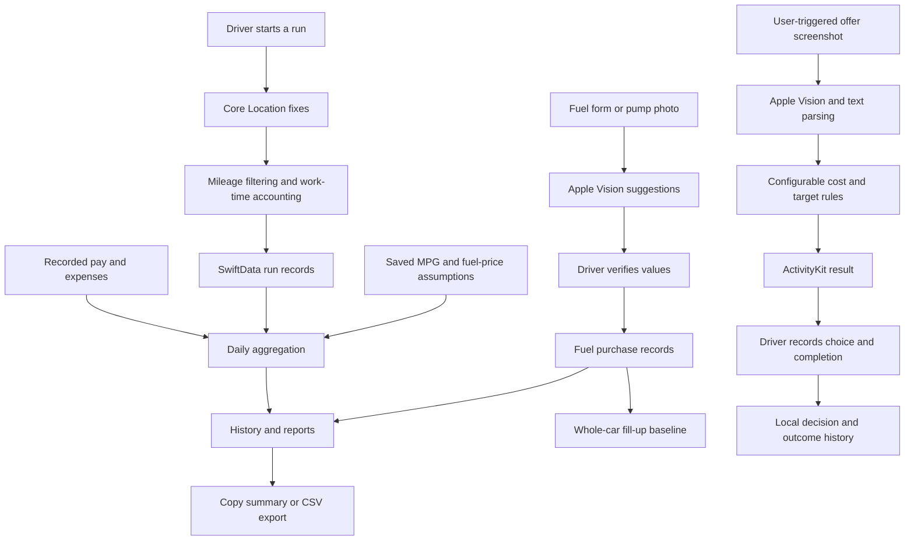

# Architecture

High-level description of the private implementation; no source files are
included in this showcase. Source checkpoint reviewed: `863a0dd` (2026-10-23).
Screenshots show a personally installed build; they are not a binary-to-commit
reproducibility guarantee.

## Data distinctions that matter

**Estimated delivery fuel** is miles divided by the saved MPG assumption, priced
with the run's saved fuel-price estimate. Historical assumptions are retained so
changing today's settings does not retroactively change a completed run.

**Actual fuel purchased** is a cash transaction. It can cover delivery and
personal driving and is not subtracted a second time from estimated run earnings.

**After-cost earnings** subtract estimated run fuel and applicable recorded costs.
Offer evaluation can additionally use a configured per-mile allowance. Neither
figure is an audited accounting profit or an after-tax take-home amount.

**Whole-car MPG** uses recorded odometer/fill-up intervals. It cannot isolate fuel
burned during deliveries without additional measurements.

**Daily pay override** replaces run-pay sums for that day, avoiding double
counting when a driver records a platform's daily total.

## On-device work and external services

OCR runs on-device. Run, fuel, preference and review data are stored locally.
There is no project-operated backend. EPA/EIA requests need connectivity; Apple
Maps may receive location/query data when its optional lookups are used.
Regional EIA data is an estimate, not a live pump quote.

The app can retain a bounded set of failed offer screenshots locally for
diagnostics (up to three, with age-based cleanup when accessed). Successful
offer screenshots are not saved by that diagnostic store. Pump photos can be
saved with local fuel records. This showcase contains none of those diagnostic
files or app backups.

## Optional OCR Lab

The private source repository includes an independent development addon for
comparing Apple Vision with the official PaddleOCR iOS integration using ONNX
Runtime and OpenCV. It measures recognition/field extraction and timings for a
user-supplied dataset. Expected answers are for scoring, not inference.

The lab's spatial-parser changes have not automatically been ported to Vroom.
A benchmark improvement therefore does not establish improved production OCR.
