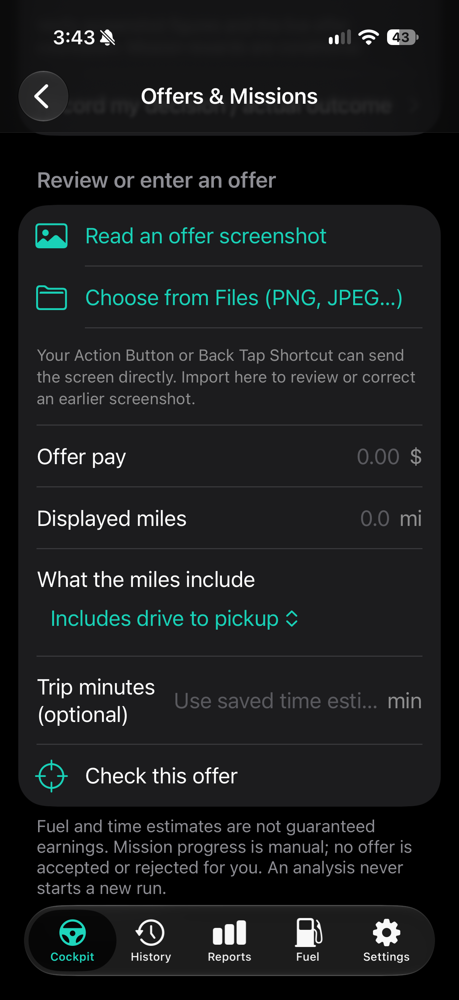
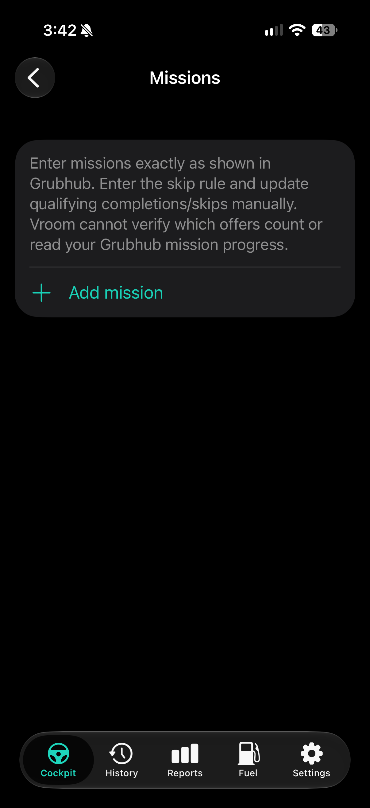

# Selected interface screens

These are actual iPhone captures of empty forms/setup screens. Hidden PNG
EXIF/XMP/text metadata has been removed; visible pixels are unchanged.
No real earnings, work dates, driving records, fuel transactions, vehicle
profiles, customer details, credentials or Home Screen captures are included.
The generic zero-value placeholders are not financial records.

## Offer import

An explicit screenshot check can use Photos or a PNG/JPEG file. Trip duration
can use saved driving/wait assumptions when no time is supplied.

## Optional mission setup

The app does not read platform mission status or verify eligibility. Progress
and skip rules must be recorded by the driver.

Other interfaces are described in the README and architecture notes. Screenshots
containing personal-use records were excluded from this public repository.
